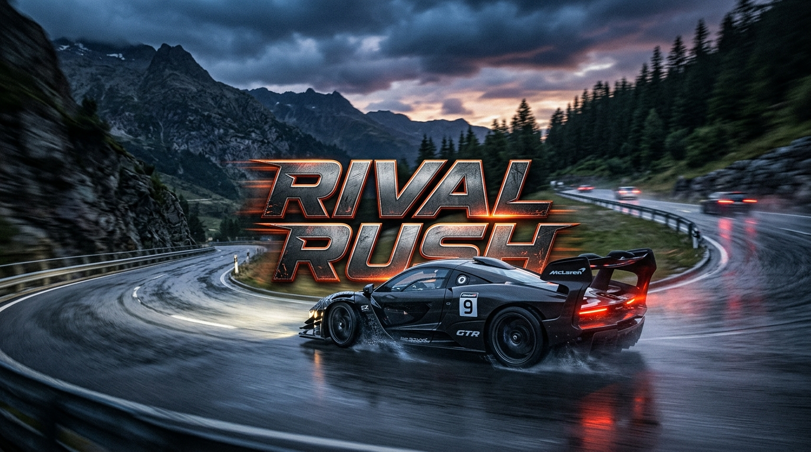
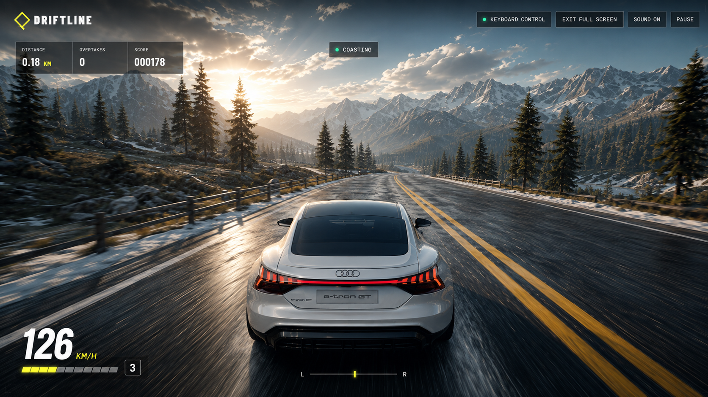
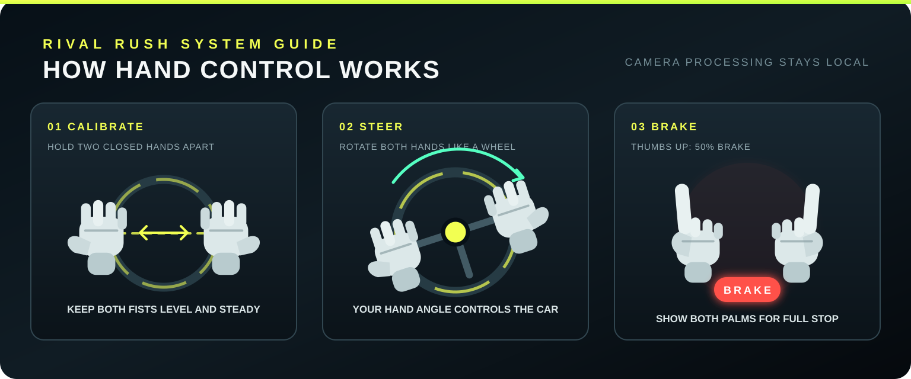

# Rival Rush



A stylized endless-driving game controlled by a two-hand virtual steering wheel. The browser tracks two closed hands locally, converts their angle into steering, and automatically manages acceleration and braking for curves and traffic.

## Gameplay



## Features & Mechanics

- **Progression System:** Your score is driven by distance and overtakes, with your personal best saved automatically to your browser.
- **Lighting & Atmospheric Shadows:** Natural directional sunlight, soft PCF shadows, and atmospheric horizon lighting create crisp, high-visibility daytime driving.
- **Collectibles & Power-ups:** Collect Gold Coins for a +500 score bonus, and hit Nitro Boosts for a massive, screen-warping burst of speed.
- **Obstacles & Collisions:** Beware of orange roadblocks and moving traffic. Collisions reduce your health and slow you down. Reaching 0% health ends the run.
- **Vehicle Customization:** Select your driver car model and apply custom paint colors using the picker on the start screen.
- **Dynamic & Accurate Weather Simulation:** Drive through changing weather conditions featuring directional velocity-aligned rain streaks, procedural fluttering snowflakes, wet asphalt road reflections with tire spray mist, cockpit windshield droplets with dynamic wind shear and wipers, procedural Web Audio rain/storm sound effects, and manual weather cycling via the topbar or `V` key (Dynamic Auto / Rainstorm / Snowfall / Clear Skies).
- **Multiple Camera Perspectives:** Toggle perspectives anytime using the topbar **CAM** button or the **C** key (or pick your starting view in the main menu). Choose between **Front Road** (first-person driver's road view), **Chase Cam** (third-person pursuit view), **Far Chase** (high aerial track view), **Hood Cam** (forward bonnet mount), and **Bumper Cam** (low asphalt speed view).
- **Sequential Gearbox & Step-by-Step Gesture Gear Controls:** Shift between 6 sequential gears (1 to 6) to control speed and acceleration one by one. While steering with your virtual wheel, extend your **right index finger (right paddle shifter)** to shift up one gear (e.g. 1 → 2). Lower your finger back into your steering fist and extend it again to advance to the next gear (2 → 3 → 4 → 5 → 6) step by step, boosting speed up to 260 km/h! Extend your **left index finger (left paddle shifter)** to downshift one gear at a time. On keyboard, tap **Shift** / **E** (gear up) and **Q** (gear down) to shift sequentially, or click the HUD paddle buttons directly.
- **Interactive Tactical Radar & Mini-Map HUD:** A top-down cyberpunk neon radar scanner displaying upcoming track curvature, road boundaries, and lane centerlines in real-time. The radar scans ahead for traffic vehicles (amber for lead traffic, flashing red for oncoming wrong-way hazards), roadblock obstacles, and collectible gold coins and nitro boosts. Features early turn warning indicators (`◀◀ HAIRPIN LEFT 45M`), multiple zoom ranges (**100M** / **160M** / **240M** toggled via click or `M` key), and animated 360° rotating radar sweep beam.
- **Realistic Main Menu Soundtrack & Dynamic Engine Audio:** Enjoy an atmospheric cinematic electronic soundtrack right on the main menu, complete with signature throttle revs and exhaust notes for each car model when selected in the showroom. In-game, engine pitch maps dynamically to vehicle speed, with a dedicated Sound Settings dialog supporting up to 200% volume boost.

## Racing

While Rival Rush focuses on endless driving and dodging traffic, you can challenge yourself to high-speed racing by:

- Overtaking cars as closely as possible to build your score combo.
- Using Nitro Boosts to achieve maximum speed and weave through tight spaces.
- Competing against your own personal best distance and score, which are saved locally to your browser.

## Run locally

```bash
npm install
npm run dev
```

Open the local URL shown by Vite in Chrome or Edge. Camera access works on `localhost` or an HTTPS deployment.

## Deploy to GitHub Pages

Push the project to your GitHub repository (e.g. `Rival-Rush`) using the `main` branch. In **Settings → Pages**, select **GitHub Actions** as the deployment source. The included workflow tests and deploys the game automatically to:

```text
https://<your-github-username>.github.io/Rival-Rush/
```

## Available car models

Choose any of these vehicles directly on the start screen, and pick a custom paint color for your ride. Traffic reuses the same model collection with randomized realistic paint colors.

| Vehicle                          | Driver car | Traffic car |
| -------------------------------- | :--------: | :---------: |
| 2017 Ford F-150 Raptor (default) |    Yes     |     Yes     |
| 2023 Ford Everest Sport          |    Yes     |     Yes     |
| Hyundai Ioniq 5                  |    Yes     |     Yes     |
| 2018 Audi e-tron GT Concept      |    Yes     |     Yes     |
| 1971 Oldsmobile Cutlass Supreme  |    Yes     |     Yes     |
| 1966 Ford GT40 Mk I              |    Yes     |     Yes     |
| Nissan Skyline GT-R R34          |    Yes     |     Yes     |
| 2006 Ford GT                     |    Yes     |     Yes     |

You can select 0, 4, 8, 12, or 16 traffic cars and choose how many different models appear. Car variety defaults to 1, which reuses the selected driver model for traffic and reduces model parsing and memory use. Higher traffic counts or model variety may reduce frame rates on lower-powered devices.

On the first visit, a setup popup keeps the game locked while it downloads approximately 20 MB of core scenery and road textures with live progress. Only selected car models are downloaded afterward; each model is stored on first use and reused on later visits. Interrupted core downloads can be retried and resume from files that are already cached.

## Controls



- **Hand mode:** hold two closed hands apart, keep them level during calibration, and rotate them like a steering wheel. Raise both thumbs for 50% braking or show both open palms for a full stop.
- **Keyboard mode:** use `W` or up arrow to accelerate, `S` or down arrow to brake and reverse, and `A` / `D` or left / right arrows to steer.
- **Camera views:** press `C` to cycle between the camera views (Front Road, Chase, Far Chase, Hood, Bumper).
- **Headlights & Lights:** click **LIGHTS** in the top bar or press **H** / **L** to cycle headlight modes (Auto, On, Off). In Auto mode, headlights turn on automatically during inclement weather (rainstorms, blizzards, fog) and turn off during crisp clear daytime. Brake lights dynamically illuminate upon deceleration.
- **Sound Settings:** click **SOUND** in the top bar to adjust Master Volume (with up to 200% volume boost), Engine roar, Synth beat, or preview with Test Sound. Audio settings are saved automatically.
- **Pause:** use the Pause button or press `Escape`.
- **Performance diagnostics:** press `F3` to toggle the performance HUD. Add `?perf=1` to the URL to open it automatically.
- **Graphics:** open Graphics in the top bar to choose Auto, Low, Medium, or High quality. The selected preset is saved locally.

Hand-control mode accelerates automatically. Keyboard mode uses manual acceleration and braking. Traffic and curve assists can slow the car in either mode. Drive on the left with same-direction traffic; the right lane carries oncoming vehicles and can be used carefully for overtaking.

## Architecture

The runtime is organized by responsibility:

- `src/app` coordinates menus, input mode, asset readiness, and game lifecycle.
- `src/game/simulation` contains deterministic gameplay rules that can be tested without WebGL.
- `src/game/world` owns reusable Three.js scene systems and their GPU-resource lifecycle.
- `src/ui` renders the static shell, startup gate, and HUD.
- `src/audio` owns the procedural Web Audio graph.
- `src/controls` contains keyboard and hand-tracking input adapters.
- `src/diagnostics` contains opt-in runtime measurements that stay disabled during normal play.

Keep game rules deterministic by passing state in and returning results. DOM and Three.js mutations should stay at the edges, and every scene system that allocates GPU resources should expose `dispose()`.

## Checks

```bash
npm test
npm run build
```

The MediaPipe runtime and hand model are copied into `public/mediapipe` during `npm install`, so camera processing happens on the device without uploading video.

## License

Original Rival Rush source code and documentation are available under the [Rival Rush Non-Commercial License](LICENSE). Commercial or for-profit use is prohibited without prior written permission. Third-party assets retain their respective licenses and attribution requirements.

## 3D asset credits

- [2017 Ford F-150 Raptor](https://sketchfab.com/3d-models/2017-ford-f-150-raptor-2be278ef4dc94d9fa00fae8b33da8273) by [Ddiaz Design](https://sketchfab.com/ddiaz-design), licensed under [CC BY-NC-SA 4.0](http://creativecommons.org/licenses/by-nc-sa/4.0/).
- [2023 Ford Everest Sport](https://sketchfab.com/3d-models/ford-everest-sport-2023-c37bec0353a94f90a3acbe09ceb3aecf) by [Asadawut.Kaewma](https://sketchfab.com/Asadawut.Kaewma), licensed under [CC BY 4.0](http://creativecommons.org/licenses/by/4.0/).
- [Hyundai Ioniq 5](https://sketchfab.com/3d-models/hyundai-ioniq-5-lowpoly-675e78311e8440d88714bd212cb7a8fb) by [andikapratamaw](https://sketchfab.com/andikapratamaw), licensed under [CC BY 4.0](http://creativecommons.org/licenses/by/4.0/).
- [2018 Audi e-tron GT Concept](https://sketchfab.com/3d-models/2018-audi-e-tron-gt-concept-e35726151c9e4a169c005d54509715fa) by [Ddiaz Design](https://sketchfab.com/ddiaz-design), licensed under [CC BY-NC-SA 4.0](http://creativecommons.org/licenses/by-nc-sa/4.0/).
- 1971 Oldsmobile Cutlass Supreme Sedan, licensed under Creative Commons Attribution.
- 1966 Ford GT40 Mk I, licensed under Creative Commons Attribution.
- Nissan Skyline GT-R R34, licensed under Creative Commons Attribution.
- 2006 Ford GT, licensed under Creative Commons Attribution.
- [Pine Tree](https://sketchfab.com/3d-models/pine-tree-d45218a3fab349e5b1de040f29e7b6f9) by [evolveduk](https://sketchfab.com/evolveduk), licensed under [CC BY 4.0](http://creativecommons.org/licenses/by/4.0/).

Attribution and license metadata are also embedded in each GLB file.
